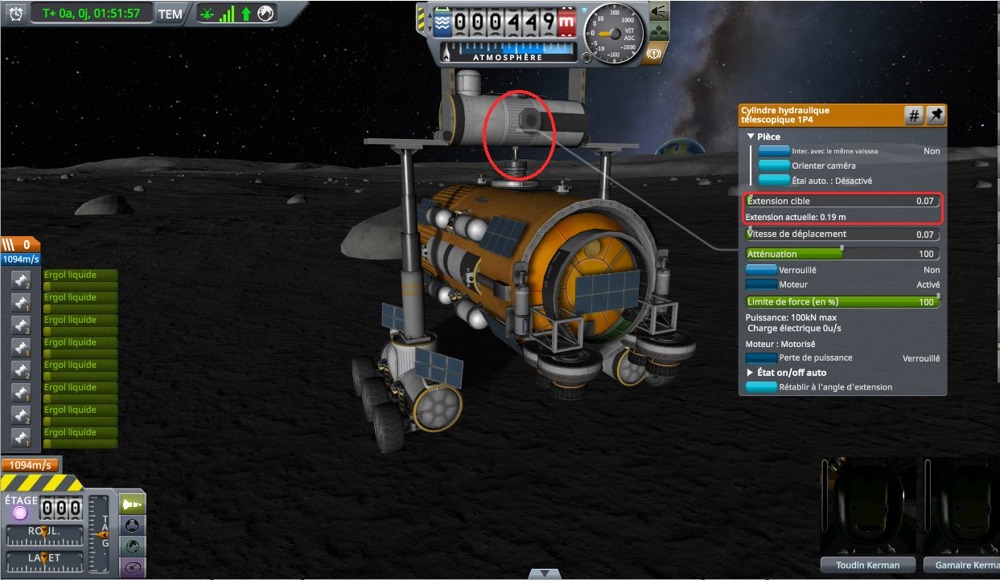

# Robotics Load Shift Fix

**⚠️ Not finished yet.** This is a new fix, not a finished mod. The code and the conclusions on this page can still change.

A fix for stock KSP 1.12, kept as small as possible: one Harmony patch, in one source file. It is a mod of its own,
built on top of [KSP Community Fixes](https://github.com/KSPModdingLibs/KSPCommunityFixes), the base most players
run, and it completes its `RoboticsDrift` patch. Here is what it fixes:

> **On load, a robotic part can move while its vessel is still on rails.** A piston stretched by its load, a hinge
> bent under an arm, springs back towards its target before physics starts. KSP Community Fixes' `RoboticsDrift`,
> which keeps the parts carried by a robotic part from drifting, follows that motion as it follows any other:
> everything the robotic part carries moves along with it. That is how a crane holding a load ends up with its wheels
> pushed into the ground, and is thrown into the air when physics starts.

It keeps the moving part of every robotic part still while its vessel loads, as the rest of the vessel is. It removes
that motion, not every hop of a heavily loaded vessel at load: see [Limits](#limits).

**How this was made.** The investigation and the code were written with Claude, Anthropic's AI
assistant. Everything here was reviewed and validated by a human — me. I am saying so up front, because
contributions made with an AI deserve a closer look than others, and because some people would rather
stop reading here. That look should be quick: the stock code involved is named and quoted on this page, and the fix
is one postfix you can read in a minute.

## Why it matters

To be honest, this mod changes something only in edge cases, and they mostly show up the same way: a rover or a
base, standing on the ground, that is pushed into it or thrown up when it loads. Most vessels with robotic parts
will load exactly as they do without it.

**The edge case: a light robotic part with heavy parts on both sides.** Under a load, an unlocked piston or hinge is
never exactly at its target: its motor is a spring, and the load bends it, by as much as the motor's settings say,
usually millimetres. Between two heavy masses, though, the physics engine holds the light robotic part much more
loosely than it is asked to: the spring it ends up with is much softer than its settings say, and the robotic part
stays centimetres away from its target. The game saves it there, bent, and the saved game is right. It is that gap
that the robotic part closes while its vessel loads, and that this mod keeps.

**An example: a crane holding a tanker.** On this crane, of about 14 t, a tanker of about 19.5 t hangs from a 1P4
piston, a part of 48 kg, unlocked, with its motor at full power. Its part action window shows the gap: a target
extension of 0.07 m, a current extension of 0.19 m. Without this mod, the piston closes these 12 cm while the vessel
is still on rails, and the crane, carried along, comes back with its wheels 12 cm in the ground before physics
starts. With it, the piston loads at the extension its window shows.

**Why the crane moves, and not the tanker: the root part is on the tanker.** A packed vessel is placed from its
root part, which comes back where it was saved; `RoboticsDrift` moves the parts on the side of the robotic part away
from the root. Here, the root part is on the tanker, so the tanker stays and the crane is moved down by the gap
the piston closes. Had the root part been on the crane, the crane would have kept its wheels where they were saved,
and the tanker would have been lifted instead, to drop back onto the piston when physics starts: a jolt, not a
crane thrown up from the ground. Which way round the piston is attached makes no difference.



*KSP 1.12 in French, on the Mun: the crane at rest, holding its tanker, the part action window of the 1P4 piston
open. The piston is circled; framed, its target extension (*Extension cible*) and its current extension (*Extension
actuelle*).*


## The culprit

**A stock defect: the moving part of a robotic part comes alive too early.** When a vessel loads, it is packed
(on rails) first: `Part.Pack` makes every `Rigidbody` kinematic, the one of a robotic part's moving part included:

```csharp
// Part.Pack (KSP 1.12)
if ((bool)servoRb)
{
    servoRb.isKinematic = true;
}
```

Then the parts start, still packed, and `BaseServo.OnStartBeforePartAttachJoint` turns that moving part back to
non-kinematic, without looking at whether its part is packed:

```csharp
// BaseServo.OnStartBeforePartAttachJoint (KSP 1.12)
if (movingPartRB != null && movingPartRB.isKinematic)
{
    movingPartRB.isKinematic = false;
    partIsPhysicsLess = false;
}
```

For the few seconds the vessel stays packed, that moving part is the only free body in it. Packed parts get no
gravity, so the load that bent the robotic part no longer pulls on it, and its motor can drive it back towards its
target position. Whether it does depends on how hard the motor pulls against the parts the moving part is attached
to, which do not move: a strong motor holding a heavy load, as on a crane, does; a weak one may not move it at all.
`Part.Unpack` would have freed it anyway, with the rest of the part, once physics starts.

**`RoboticsDrift` turns that motion into a shift of the vessel.** On stock, a packed vessel is placed from the saved
positions of its parts (`Part.orgPos`), so the moving part pulls, but nothing else follows. KSP Community Fixes
`RoboticsDrift` rightly replaces the stock update of these saved positions after a robotic part moves: it moves the
parts the robotic part carries by the moving part's own displacement along its axis, instead of reading back
positions bent by physics, which made them drift for good. It cannot tell that this displacement is not a real one:
the parts on the side of the robotic part away from the vessel's root are moved by the amount it was bent, and the
packed vessel is placed from these new positions.

## Checking the culprit

The crane, without its wheels, is saved at rest, then loaded again held on rails by [KSP Diag - On
Rails](https://github.com/lhervier/KSP-Diag-OnRails). Without this mod, its tanks stand about 61.5 mm deeper in
the ground than with it: the 0.06 m gap its piston showed before saving.

**→ Full chapter: [Checking the culprit: the crane held on rails](docs/checking-the-culprit-crane.md)**

## The fix

One patch, with its switch in [Settings](#settings), on by default. Nothing is saved; removing the mod gives the
behaviour without it back at once.

- **`servoStillWhilePacked`.** A postfix of `BaseServo.OnStartBeforePartAttachJoint` turns the moving part back to
  kinematic when its part is packed. `Part.Unpack` frees it with the rest of the part when physics starts, as it does
  without the mod. Every robotic part goes through this method: pistons, hinges, rotation servos and rotors.

A robotic part started while its vessel is not packed is left to the stock code. If the stock method is missing,
nothing is patched, with an error in `KSP.log`.

**Why not change `RoboticsDrift`.** It is right: the moving part did move. What is wrong is that it could move at all
while the rest of the vessel was packed.

**Why keep the moving part where it was saved.** That bent position is where the load and the motor were balanced
when the game was saved: physics starts from it, as if the vessel had never been unloaded.

## Limits

**This mod removes the shift, not every hop at load.** Two other stock behaviours can make a heavily loaded vessel
hop when it loads, with or without it:

- **A saved vessel keeps the shape it was built with, not the shape its joints were bent into.** `ProtoPartSnapshot`
  saves each part's `Part.orgPos`, and on load every part but the root goes back there. Light parts carrying a heavy
  load, such as small docking ports, bend the most: the parts beyond them come back where they would be without the
  load, possibly in the ground.
- **Wheels whose suspension is pressed to its stop by the load.** The suspension spring is not saved: it is worked
  out again from the vessel's mass only once physics runs and the wheel touches the ground
  (`ModuleWheelSuspension.FixedUpdate`), so the wheel starts without it.

Setting the load down before saving avoids all three.

## Work in progress

What a player would see if this mod broke something, or what it should fix but was not checked yet, and how to try
it by hand, with the mod and without:

- **A hinge bent by its load.** Hold a heavy part at the end of an arm on an unlocked hinge, on the ground, with the
  root of the vessel on the hinge's moving side, then save and load. Without the mod, the rest of the vessel should
  be rotated by the bend when it loads; with the mod, nothing should move.
- **A rotation servo or a rotor under load**, the same way.
- **A robotic part moving when the game is saved.** Save while a piston extends, and load: it should go on
  extending to its target, with the mod as without.
- **A vessel that comes within the physics range** with a loaded robotic part: it should not jump, with the mod.
- **A locked robotic part** should behave as without the mod.
- **A robotic part placed in EVA construction mode**, and **a vessel with robotic parts that docks**, should behave as
  without the mod.

## Install

Copy the `GameData\KSPFixRoboticsLoadShift` folder into the `GameData` folder of KSP. It needs
[Harmony](https://github.com/KSPModdingLibs/HarmonyKSP), as KSP Community Fixes does. It only acts on the robotic
parts of the Breaking Ground expansion.

## Settings

`GameData\KSPFixRoboticsLoadShift\PluginData\settings.cfg` is read once, when KSP starts:

```
// Keeps the moving part of a robotic part still while its vessel loads, as the rest of the vessel is.
servoStillWhilePacked = True

// How much the mod writes to KSP.log: Error, Warning, Info or Debug.
logLevel = Info
```

- With `servoStillWhilePacked = False`, nothing is patched: a loaded robotic part springs back while its vessel
  loads, as without the mod.
- At `Debug`, the mod writes one line per robotic part kept still, each time its vessel loads.

## Build

Set `KSPDIR` to the folder of a KSP install with Harmony in its `GameData`, then run `build.bat`: it
compiles `GameData\KSPFixRoboticsLoadShift\KSPFixRoboticsLoadShift.dll`. Installing is up to you.

## License

[MIT](LICENSE).
