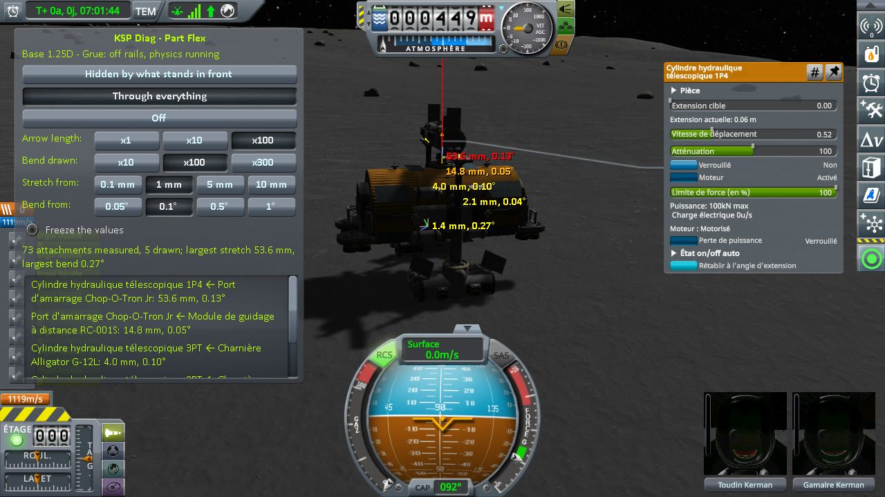
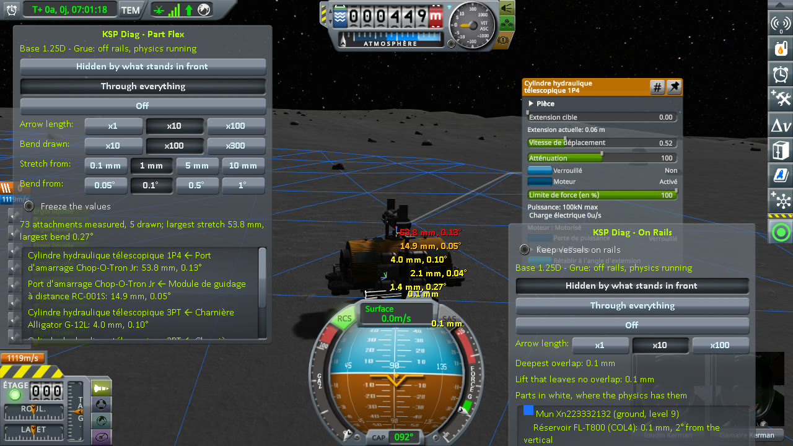
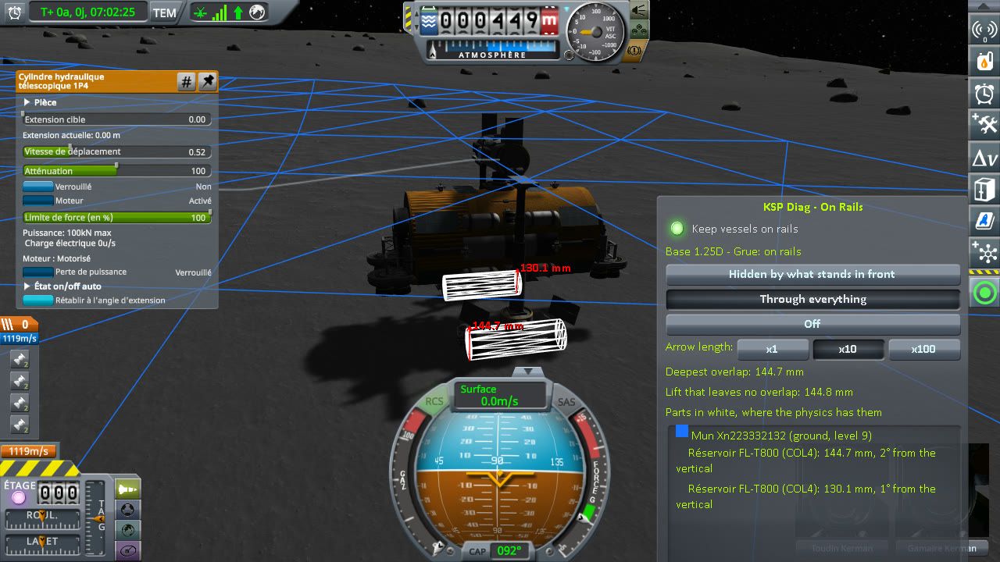

# Checking the culprit: the crane held on rails

Part of [Robotics Load Shift Fix](../README.md). The crane of [Why it matters](../README.md#why-it-matters),
without its wheels, is saved at rest, then the save is loaded again while the vessel is kept on rails: how deep
are its tanks in the ground before physics starts, without this mod and with it? Two diagnostic mods take the
readings, and the part action window of the piston gives the last one.

Where the crane comes back when it loads depends on four things. The protocol takes two of them out of the way and
measures the other two:

- **The ground.** KSP never builds the ground at quite the same height twice: from one load to the next, the
  surface under the crane is not where it was. [Terrain Precision
  Fix](https://github.com/lhervier/KSP-Fix-TerrainPrecision) builds it at the same height every time, and is
  installed for this test.
- **The suspension of the wheels.** Pressed by the load, it is not saved, and comes back only once physics runs
  (see [Limits](../README.md#limits)). The crane's wheels were removed: it stands on two of its FL-T800 tanks.
- **The shape the physics gives the crane.** Under the 19.5 t of the tanker, the physics stretches and bends the
  attachments of the light parts, and the crane settles on the ground in that shape. The save keeps the shape the
  vessel was built with, not that one (see [Limits](../README.md#limits)): the crane comes back lower by as much.
  KSP Diag - Part Flex shows these attachments before saving; with this mod, the depth KSP Diag - On Rails reads
  on rails is what they leave. Not this mod's concern.
- **The piston.** Saved stretched by its load, away from its target, it closes that gap while the vessel is on
  rails, and `RoboticsDrift` moves the crane along with it (see [The culprit](../README.md#the-culprit)). This is
  what this test measures, as the difference between the runs without and with this mod, and what this mod
  brings to zero.

## The install

KSP 1.12.5 with the Breaking Ground expansion, and [KSP Community
Fixes](https://github.com/KSPModdingLibs/KSPCommunityFixes) 1.41.1 (and the Harmony and Module Manager it needs),
its `RoboticsDrift` patch on, as it ships. On top of them:

- [Terrain Precision Fix](https://github.com/lhervier/KSP-Fix-TerrainPrecision) 0.3.0, for the ground under
  the crane, built at the same height at every load: the depths below compare loads with one another.
- [KSP Diag - On Rails](https://github.com/lhervier/KSP-Diag-OnRails) and [KSP Diag -
  Part Flex](https://github.com/lhervier/KSP-Diag-PartFlex), the two instruments described below.
- This mod, 0.1.0, its log level set to `Debug` in `PluginData/settings.cfg`. *Without this mod* below means
  the same install with `servoStillWhilePacked = False` in that file; KSP reads it when it starts, so quit KSP,
  edit the file and start KSP again to switch.
The game is in French on the screenshots: the part action window of the piston names its target extension
*Extension cible* and its current extension *Extension actuelle*; the Clamp-O-Tron Jr. docking port is the *Port
d'amarrage Chop-O-Tron Jr*, the RC-001S Remote Guidance Unit the *Module de guidage à distance RC-001S*, the 1P4
Telescoping Hydraulic Cylinder the *Cylindre hydraulique télescopique 1P4*, the FL-T800 Fuel Tank the *Réservoir
FL-T800*.

## The crane and the instruments

On this crane, the tanker hangs from the 1P4 piston through two Clamp-O-Tron Jr. docking ports, docked to each
other; the upper one is attached to the piston, the lower one to an RC-001S on the tanker. These two attachments
are the ones the physics stretches the most. The vessel's root part is on the tanker, so when the crane is loaded
again, the tanker comes back where it was saved and the crane is placed from it (see [Why it
matters](../README.md#why-it-matters)): the stretch the save does not keep, and the gap the piston closes, both
bring the crane down.

Each reading comes from an instrument a player can open:

- **KSP Diag - Part Flex** shows, for each part, how far the physics stretches its attachment to its parent, in
  mm, and how far it bends it, in degrees: its window lists them, largest first. It reads the stretch before
  saving.
- **The part action window of the piston** shows its target extension and its current extension, to the
  centimetre: their difference is the gap.
- **KSP Diag - On Rails** keeps the vessels on rails while the box *Keep vessels on rails* of its window is
  ticked, and shows how deep the vessel stands in the ground: its window lists each part in it with its depth, in
  mm.

## The protocol

The save is [robotics-load-shift.sfs](../diag/robotics-load-shift.sfs): a sandbox game with the crane on the Mun,
in the morning, holding its tanker, without its wheels. Copy it into the folder of a sandbox game.

1. **Let the crane settle.** Load the save. Physics starts, the crane hops (the stretch was not saved), then
   settles. Wait until the navball shows a surface speed of 0.0 m/s, about thirty seconds.
2. **Read the gap.** Right-click the 1P4 piston, circled in the screenshot of [Why it
   matters](../README.md#why-it-matters), to open its part action window. Note its target extension and its current extension.
3. **Read the stretch.** In the window of Part Flex, note the stretch of the two attachments that hold the
   tanker: *1P4 ← Clamp-O-Tron Jr.* and *Clamp-O-Tron Jr. ← RC-001S*.
4. **Save at once**, under a name of your own, here `checking`. The stretch is different each time the crane
   settles: the readings of steps 2 and 3 belong to this save only.
5. **Load the save on rails, with this mod.** Tick *Keep vessels on rails* in the window of On Rails, and load
   `checking`. Wait ten seconds. Note the depth of each FL-T800 in the window of On Rails, and the current
   extension of the piston in its part action window.
6. **The same, without this mod.** Quit KSP, set `servoStillWhilePacked = False`, start KSP, tick *Keep vessels
   on rails* again, load `checking`, wait ten seconds, and note the same readings.

## Before saving: steps 1 to 3



*Step 3, just before saving. Part Flex draws through everything, arrows a hundred times as long as the stretch:
the red arrow, upwards, is the attachment of the piston, pulled by the tanker. Its window lists, first, the 1P4 ←
Clamp-O-Tron Jr. at 53.6 mm and the Clamp-O-Tron Jr. ← RC-001S at 14.8 mm. The part action window of the piston
shows a target extension of 0.00 and a current extension of 0.06 m.*

Read off the screenshot:

| Reading | Value |
|---|---|
| Stretch, 1P4 ← Clamp-O-Tron Jr. | 53.6 mm |
| Stretch, Clamp-O-Tron Jr. ← RC-001S | 14.8 mm |
| Stretch of the chain that holds the tanker | 53.6 + 14.8 = **68.4 mm** |
| Piston, target extension | 0.00 m |
| Piston, current extension | 0.06 m |
| Gap of the piston | 0.06 − 0.00 = **0.06 m**, to the centimetre |

The other attachments listed are under 5 mm. At that moment, with physics running, the tanks stand on the
ground: On Rails, opened a few seconds earlier, showed one FL-T800 at 0.1 mm in it.



*Step 2, about twenty seconds before saving, before the screenshot above was framed: the window of On Rails, on
the right, lists one FL-T800 at 0.1 mm in the ground, physics running.*

## On rails, with this mod: step 5


*Step 5: `checking` loaded with* Keep vessels on rails *ticked, ten seconds later. On Rails draws through
everything, arrows ten times as long as the depth; the two FL-T800 the crane stands on are drawn in white where
the physics has them.*

The window of On Rails lists the two FL-T800 at **83.2 mm** and **68.7 mm** in the ground. The part action window
of the piston still shows a current extension of **0.06 m**: its moving part did not move. A second load of
`checking` gave the same depths, to the tenth of a millimetre. `KSP.log` has one line for each robotic part of the
crane, the 1P4 among them:

```
[KSPFixRoboticsLoadShift] [DEBUG] Moving part of piston.04 (1748300280) of Base 1.25D - Grue kept still while packed
```

## On rails, without this mod: step 6



*Step 6: the same save, the same framing, ten seconds after loading, without this mod.*

Right after loading, the window of On Rails shows the same depths as with this mod. Within a few seconds, both
tanks go deeper, then stop: **144.7 mm** and **130.1 mm**. The part action window of the piston now shows a
current extension of **0.00 m**, its target: its moving part went back to it while the vessel was on rails.
`KSP.log` has no *kept still while packed* line.

## What the readings say

| FL-T800 | With this mod | Without this mod | Difference |
|---|---|---|---|
| The deeper one | 83.2 mm | 144.7 mm | 61.5 mm |
| The other one | 68.7 mm | 130.1 mm | 61.4 mm |

**Without this mod, the crane goes down by the gap of the piston.** Both tanks go deeper by the same amount, 61.5
and 61.4 mm: the whole crane moved down as one block, along the piston. That is the gap the part action window
showed before saving, 0.06 m to the centimetre, and the current extension that went from 0.06 to 0.00 m on rails
is that gap closing. With this mod, the current extension stays at 0.06 m, and the piston does not move the
crane.

**What is left with this mod is the stretch that was not saved.** The 68.4 mm Part Flex showed before saving, on
the two attachments that hold the tanker, are of the same order as the depths left with this mod. The two tanks
are not as deep as each other because the attachment of the piston was bent too, by 0.13°: put back straight, it
tips the crane. This part of the depth is the first cause of [Limits](../README.md#limits), and this mod leaves
it.

The readings come from one save: loading `checking` again gives the same depths, but a save made after the crane
settled another time holds another stretch, and so other depths. The difference between the runs without and with
this mod is the gap of the piston, read in its part action window before saving.
